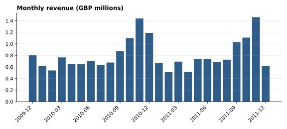
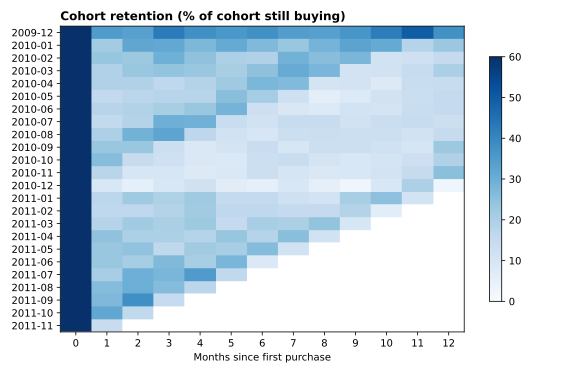
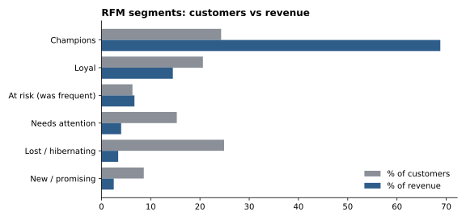

# Retail cohort lab

Cohort retention, revenue KPIs and RFM segmentation for a UK online retailer, done in plain SQL on DuckDB, with a small Streamlit dashboard on top.

The question: how much of the revenue comes from a small group of repeat customers, and do newly acquired customers stick around?

## Data

[UCI Online Retail II](https://archive.ics.uci.edu/dataset/502/online+retail+ii): 1,067,371 invoice lines from Dec 2009 to Dec 2011. About 22.8% of raw rows have no customer id, so customer-level analysis uses the 5,853 identified customers. Revenue KPIs use all sales lines.

## Method

All logic lives in `sql/` and runs in order:

1. `01_clean.sql` - types, cancellations and returns split out, line revenue.
2. `02_kpis.sql` - monthly revenue, orders, new vs returning customers.
3. `03_cohorts.sql` - first-purchase cohorts, monthly retention and cumulative revenue per customer.
4. `04_rfm.sql` - recency, frequency and monetary scores and six named segments.

`tests/test_sql.py` checks the views on a small synthetic dataset.

## Findings

- Champions are roughly 24% of identified customers and bring about 69% of identified-customer revenue in the saved analysis run. The top 10% of customers make 63.9%.
- Month-1 retention averages 21.0% across cohorts of at least 50 customers. After that it drifts between about 15% and 22% (month 6: 17.9%, month 12: 18.3%) instead of decaying to zero, which is consistent with a core of repeat buyers in the observed period.
- The UK is about 86% of revenue (17.24M of 20.12M GBP).
- Returns are 7.6% of sales value.
- The two Novembers are the top months (Nov 2010: 1.437M, Nov 2011: 1.459M).





## Run it

```bash
pip install -r requirements.txt
# download online_retail_II.xlsx from the UCI page above into data/
python src/load.py          # builds data/retail.duckdb
python src/run_sql.py       # runs the SQL and prints a summary
python src/make_figures.py  # rewrites docs/*.svg
streamlit run src/dashboard.py
pytest
```

## Limitations

- Rows without a customer id are excluded from cohorts and RFM, so retention is for identified (mostly registered) customers only.
- Two years of data means later cohort months rest on few cohorts.
- RFM thresholds are quantile based and describe this dataset, not a general rule. NTILE ties now break on customer ID, so scores and segment counts are identical on every run. The saved segment figure was generated before that fix, so a few borderline customers may sit one bucket off.
- No causal claims: this is descriptive.

MIT licensed.
